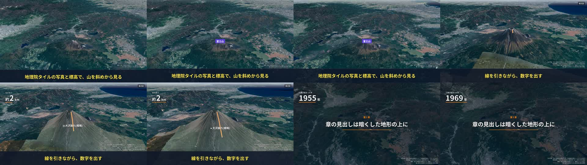
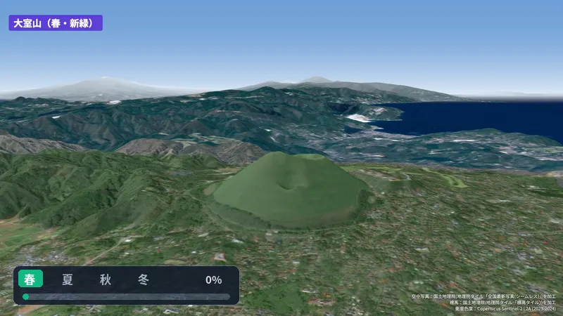
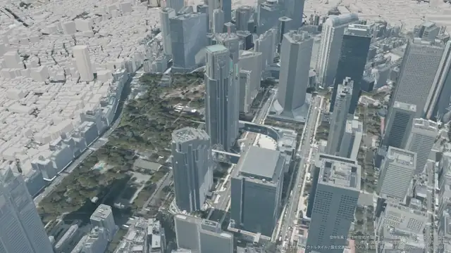
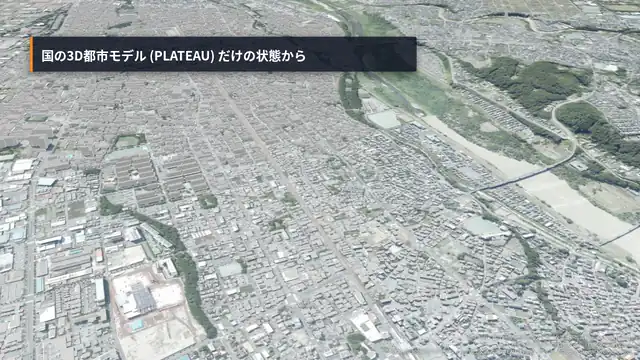

# geo-video-factory

`geo-video-factory` は、地理・歴史・土木の解説動画を AI エージェントに作らせるためのスキル集とレンダラーです。

地理院タイルの空中写真と標高で地形を 3D にし、その上をカメラがゆっくり動きます。川を線で引き、範囲を塗り、地名や数字を出し、昔の空中写真と今を切り替えます。そこに VOICEVOX の 2 人の掛け合いと字幕、立ち絵を付けた mp4 を、ショットの JSON から何度でも同じに書き出します。



上の画像は、テンプレートに入っているサンプル `shots/example.json` を `--stills 2` で書き出したものです。背景は地理院タイルの写真と標高、引いた画は NASA Blue Marble です (出典は画面の右下に自動で入ります)。

大室山の四季の例です (E2E テスト `terrain-mt-omuroyama`)。手前に大室山、左奥に富士山、右奥に相模湾を望む固定カメラのまま、Copernicus Sentinel-2 L2A 衛星データから抽出した季節ごとの色度（春の新緑・夏・秋・冬の山焼き）を地理院タイルの空中写真へ転写し、滑らかに切り替えています。



東京の 3D 建物の例です (E2E テスト `buildings-tokyo-sota` の一部)。新宿では、PLATEAU でテクスチャの無い白い建物に、屋根は空中写真、壁は推定した外壁を付けていきます。羽村市は PLATEAU が 0 棟なので、地理院ベクトルタイルの建物の形から、隣の福生市の PLATEAU で較正した高さを推定して建物を立て、そこへ屋根の空中写真と、屋根の見た目から推定した外壁を付けていきます。下の 2 本目の動く画像は、羽村市と福生市を引きで見たところです。





## できること

- 地形を斜めから見て、寄る、回り込む、川に沿って流す、広域へ引いてから別の場所へ寄る
- 線を上流から下流へ伸ばして描く、範囲を塗る、地名や札を地形に貼る、数字を数え上げる、章の見出しを出す
- 過去の空中写真と現在の写真を切り替える、写真を撮影地点と線で結ぶ (EXIF の GPS から)
- VOICEVOX で複数の話し手の掛け合いを合成し、声の長さに合わせてショットを伸ばし、字幕を入れる
- 話し手の立ち絵を画面の隅に出し、声に合わせて口を動かし、まばたきさせる
- 都市の 3D 建物を出す。PLATEAU があればそれを使い、無い建物は地理院の建物の形と空中写真から高さと外壁を推定して補う
- 章ごとに並列で書き出し、無音のタイトルカードを挟んで 1 本につなぎ、音量を -14 LUFS 前後にそろえる

## スキル

エージェントが読むスキルは `.agents/skills/` にあります。Claude Code は `.claude/skills` (同じ場所への symlink) から、Codex は `.agents/skills` から読みます。

| スキル | 受け持ち |
|---|---|
| [geo-video-production](.agents/skills/geo-video-production/SKILL.md) | 企画、章立て、素材と出典、地名と経路の調べ方、並列の書き出し、検品、公開用の概要欄 |
| [geo-video-renderer](.agents/skills/geo-video-renderer/SKILL.md) | レンダラー本体、ショット JSON の書式、地理院タイル、書き出しの不具合 |
| [geo-video-3d-terrain](.agents/skills/geo-video-3d-terrain/SKILL.md) | 標高タイル (`gsidem` / `mapterhorn`) の選択と変換、3D 地形の強調・陰影・描画の制約 |
| [geo-video-satellite-imagery](.agents/skills/geo-video-satellite-imagery/SKILL.md) | Sentinel-2 L2A 等の衛星データ取得、SCL 雲判定、地理院オルソへの季節色度転写、出典表記 |
| [geo-video-3d-buildings](.agents/skills/geo-video-3d-buildings/SKILL.md) | PLATEAU・OpenStreetMap・地理院オルソによる都市の 3D 建物映像、PLATEAU 3D Tiles の取得・固定化、欠損建物の補完と質感 |
| [geo-video-camera](.agents/skills/geo-video-camera/SKILL.md) | カメラの技法、速度、データの範囲、ラベルの重なりの検品 |
| [geo-video-narration](.agents/skills/geo-video-narration/SKILL.md) | VOICEVOX、掛け合い、字幕、読み違い、立ち絵、BGM |
| [geo-video-bgm](.agents/skills/geo-video-bgm/SKILL.md) | BGM の選定・ローカル合成、自動ダッキング、`-14 LUFS` 音量マスタリング |
| [geo-video-thumbnail](.agents/skills/geo-video-thumbnail/SKILL.md) | 代表フレーム抽出と 1280×720 YouTube サムネイルの設計・自動生成 |
| [geo-video-visuals](.agents/skills/geo-video-visuals/SKILL.md) | 写真、地名、図解、テロップ、画面効果、編集の技法 |
| [geo-video-art-direction](.agents/skills/geo-video-art-direction/SKILL.md) | 画面全体の構図、文字造形と尺度差、3層情報密度、静止と変化、ビジュアル検品 |
| [geo-video-console-layout](.agents/skills/geo-video-console-layout/SKILL.md) | 防災・インフラ・観測向けの管制コンソール・診断・警戒区画風レイアウトと状態遷移 |
| [geo-video-visualize](.agents/skills/geo-video-visualize/SKILL.md) | 2D / 3D コロプレス図（`choropleth` / `fill-extrusion`）、配色・階級区切り・NoData・時系列共通尺度の設計 |
| [geo-video-materials](.agents/skills/geo-video-materials/SKILL.md) | いらすとや・Wikimedia 等の素材収集、ライセンス確認、重複・EXIF 監査、出典・画像 ID 管理 |
| [geo-video-reference-analysis](.agents/skills/geo-video-reference-analysis/SKILL.md) | 良いと感じた動画の構成、編集、声、題とサムネイル、再生数や登録者数との比を分析し、持ち帰る型を提案する |

エージェント向けの案内は [AGENTS.md](AGENTS.md) にあります。

Node.js、Python、FFmpeg、Playwright、VOICEVOX などの共通環境は、[SETUP.md](SETUP.md) の手順で準備してください。

## 使い方

### エージェントに頼む

このリポジトリを clone し、その中で Claude Code や Codex を起動して、作りたい動画を伝えます。

```
富士山の大沢崩れについて、2 人の掛け合いで 3 分の解説動画を作ってください
```

エージェントは `geo-video-production` から始め、章立てと素材を決め、テンプレートを作業ディレクトリへコピーしてショットを書き、書き出して確かめます。作業ディレクトリは `projects/YYYY/MM/DD/<slug>/` (作業を始めた日と題材の名前) です。`projects/` には作例が 2 本あります。画像、動画、音声はリポジトリに含めず、出典の記録だけを残しています。

### レンダラーを直接使う

レンダラー本体は TypeScript 製の共通パッケージ ([packages/renderer/](packages/renderer/))、章結合や EXIF 等の補助ツールは ([packages/pipeline/](packages/pipeline/)) にあります。各プロジェクトにはデータ（`shots/*.json`、`assets/`、`characters/`）だけを置き、共通レンダラーを `--project` 付きで呼び出します。

```bash
# 初回セットアップ (リポジトリルートから)
cd packages/renderer
npm install
npm run build
npx playwright install chromium-headless-shell

# 新規プロジェクトのデータ雛形をコピー
cd ../..
cp -a .agents/skills/geo-video-renderer/assets/template/. projects/2026/11/15/my-video/

# 構図の確認: 2 秒おきの静止画を 1 枚に並べる (声は合成しない)
node packages/renderer/dist/src/render.js projects/2026/11/15/my-video/shots/example.json --out projects/2026/11/15/my-video/out/example --stills 2 --no-voice

# 本番: コマを書き出して mp4 にする
node packages/renderer/dist/src/render.js projects/2026/11/15/my-video/shots/narrated.json --out projects/2026/11/15/my-video/out/narrated
```

ショット JSON の書き方は [shots.md](.agents/skills/geo-video-renderer/references/shots.md)、声と字幕は [narration.md](.agents/skills/geo-video-narration/references/narration.md) にあります。全パッケージの型検査、単体テスト、カバレッジ検査は、リポジトリのルートで `packages/test.sh` を実行します。

`packages/` 全体の TDD 方針、カバレッジ基準、統合テストの実行方法は [packages/TESTING.md](packages/TESTING.md) を参照してください。

### 必要なもの

- Node.js と Playwright の Chromium
- ffmpeg と ffprobe
- 日本語フォント (Noto Sans CJK JP)
- VOICEVOX エンジン (声を付けるとき。既定は `http://127.0.0.1:50021`)
- Python 3 と Pillow (章をつなぐ `chapter_pipeline.py`、写真の EXIF を読む `photo_geo.py`)
- GPU があると速く書き出せます。GPU の無い環境では `FLYOVER_GL=swiftshader` でソフトウェア描画にできますが、遅く、地形の重い画ではタイムアウトすることがあります ([troubleshooting.md](.agents/skills/geo-video-renderer/references/troubleshooting.md))

## 地名、位置、経路のサービス

台本の地名を座標にする、川や路線の形を取る、経路を描く、現代の地名を重ねるために、OpenStreetMap のデータで動く次のサービスを使えます。

- Nominatim: https://nominatim.yuiseki.net
- Overpass API: https://overpass.yuiseki.net/api/interpreter
- Valhalla: https://valhalla.yuiseki.net
- ベクトルタイル (OpenMapTiles): https://tile.yuiseki.net

データの時点、クエリの例、落とし穴は [osm-services.md](.agents/skills/geo-video-production/references/osm-services.md) にあります。まとめて大量に問い合わせず、結果は手元に保存して使い回してください。

## 素材と出典

書き出した動画には、使った素材の出典が画面の右下に自動で入ります。公開するときは、概要欄にも書いてください。

- 地理院タイル (写真、標高、過去の空中写真): 国土地理院。出典を書けば使えます。加工したら「〜を加工して作成」と書きます
- NASA Blue Marble: NASA Earth Observatory / NASA GIBS
- 地名と経路: © OpenStreetMap contributors (ODbL)、OpenMapTiles
- 声: VOICEVOX。「VOICEVOX:キャラクター名」の表記が必要で、キャラクターごとの規約もあります

立ち絵の PSD はこのリポジトリに含めていません。`characters/` にあるのは、坂本アヒル氏の「ずんだもん立ち絵素材」「四国めたん立ち絵素材」のレイヤーを選ぶ設定だけです。素材は配布元から入手し、東北ずん子・ずんだもんプロジェクトのガイドライン (https://zunko.jp/guideline.html) に従って使ってください。

## ライセンス

[Apache License 2.0](LICENSE)

このライセンスはリポジトリのコードと文書に適用されます。地図のタイル、標高、OSM のデータ、合成した声、立ち絵などの素材には、それぞれの提供元の利用条件が適用されます。
