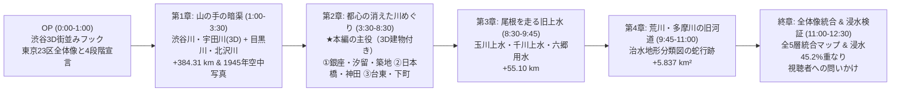

# 動画構成・コンテ図：`tokyo-river-recall`（都心フォーカス改訂版）

- **プロジェクト**: `projects/2026/11/19/tokyo-river-recall/`
- **想定尺**: 約 12〜14分
- **基本コンセプト**:
  1. **東京の全体像（「消さずに積む地図」）**: 23区全体の俯瞰で、現行河川（`369.79 km`）の上に4層の失われた川（暗渠・谷筋 `384.31 km` → 埋立掘割 `20.13 km / 0.993 km²` → 旧上水 `55.10 km` → 旧河道 `5.837 km²`）を順番に積み上げて全体像を示す。
  2. **都心の「いまは見えていない川」の個別紹介（3D建物付き）**: 特に都心部（渋谷、銀座・汐留・築地、日本橋・神田、浅草・台東）では **PLATEAU 3D建物＋擬似建物＋擬似テクスチャ** の立体街並みへ降り立ち、「ここも川だった！」を1本ずつ個別に巡って紹介する。

---

## 1. 全体構成（マクロ俯瞰 × 都心ミクロ深掘り）

---

## 2. 都心の「いまは見えていない川」紹介リスト（第1章冒頭＋第2章）

| エリア（3D建物カバー） | 個別に紹介する川・掘割 | 今の姿と「意外な目印」 |
|---|---|---|
| **渋谷** (`shibuya` 準備済) | **渋谷川（暗渠）・宇田川・河骨川** | センター街、キャットストリート、宮益坂下・JR渋谷駅直下 |
| **銀座・新橋・築地** (`ginza` 準備済) | **三十間堀** | 昭和通りの1本西側、銀座東のビル街・駐車場地下 |
| | **京橋川・汐留川・外濠川** | 東京高速道路（KK線）の真下をぐるっと囲むルート |
| | **築地川（本流・南/東支川）** | 首都高都心環状線（C1）の掘り割りと築地川公園群 |
| | **桜川** | 八丁堀〜新富町を東西に抜ける街区 |
| **日本橋・神田** (`nihonbashi` 追加予定) | **楓川** | 首都高C1（江戸橋JCT〜京橋JCT）の真下 |
| | **東堀留川・西堀留川** | 人形町・小舟町のオフィス街に突き刺さっていた2本の入堀 |
| | **龍閑川** | 神田駅南側〜日本橋の区境を東西に走る細街路 |
| | **浜町川・箱崎川** | 浜町緑道・浜町公園脇、箱崎JCT周辺 |
| **台東・墨田・江東** (`asakusa` 追加予定) | **三味線堀** | 台東区鳥越・小島（新堀通り） |
| | **山谷堀** | 吉原大門〜浅草北側〜隅田川・待乳山聖天横 |
| | **大横川・竪川** | 墨田・江東の親水公園・首都高7号線高架下 |

---

## 3. コンテ図・演出ルール（`storyboard_v03` / `storyboard_3d_v01` で検証済み）

- **動的カメラワーク**: すべての都心紹介ショットは「**街角・高速道路の寄り（川が見えない状態）→ 青い川が出現 → 引き／トラッキングで水系との繋がりを示す**」の2段展開にする。
- **3D建物と広域の編集点**:
  - 3D建物（PLATEAU＋擬似建物＋擬似テクスチャ）を使う都心ショットは、必ず各エリアの BBOX 内にカメラを収め、広域説明へ移る際はカット（編集点）を挟んで2D/地形地図ショットへ切り替える。
- **UI余白ルール**:
  - 左上タグは `screen` の中心座標が切れないよう文字長に応じて右にオフセットする。
  - 右上 `counter` は右上の `note`（再現イメージ注記）と重ならないよう `y = 110` 以上に配置する。
